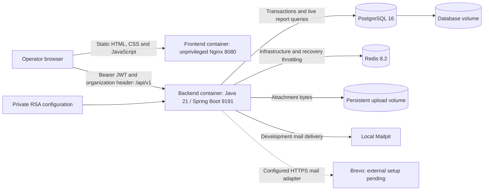
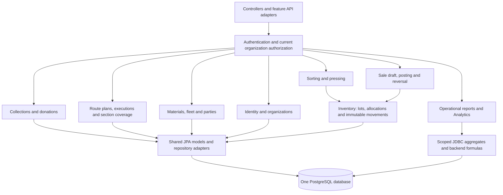
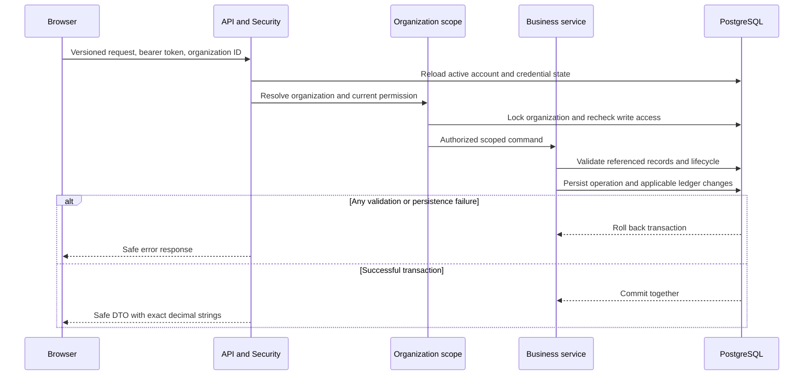
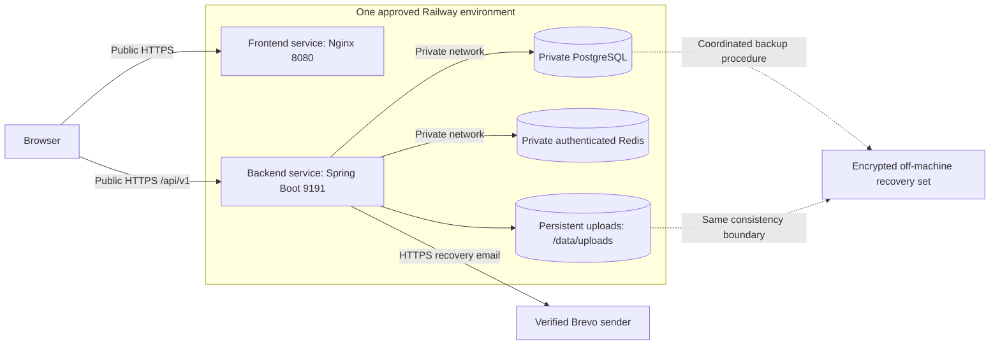
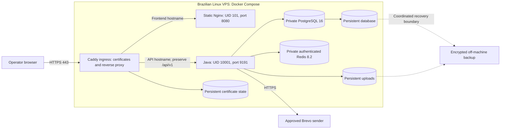

# IRR architecture diagrams

Maintainer: [Enzo Ribas (@oEnzoRibas)](https://github.com/oEnzoRibas). Reviewed 2026-10-10 against the current repositories.

These diagrams describe the implemented modular monolith and the proposed Railway installation separately. They continue ADR-0003/0014, organization boundaries, the stock ledger and approved reporting ADRs. They do not introduce microservices, a strict hexagonal rewrite or Kubernetes. See [responsibilities and transaction rules](readme.md) and [release readiness](../release-readiness.md).

## Implemented runtime

The browser calls the API directly; Nginx serves static assets and SPA fallback, not application business logic. Local frontend port 5173 maps to container 8080. The active backend worktree uses host 9292; the standard development default is 9191. Neither is a production hostname. PostgreSQL owns durable business truth and authorization associations; Redis is not the stock ledger. Attachment bytes and database metadata require coordinated recovery. Mailpit is local-only; external Brevo delivery is not yet accepted.

## Backend module boundaries

Modules share one JVM and relational database. Feature-owned packages coexist with established controllers/services and shared JPA models; this is the pragmatic hybrid documented by ADR-0003. The diagram shows responsibilities, not a claim that every dependency is enforced by a module framework. Processing/sales coordinate ledger writes transactionally; intake alone does not credit saleable inventory. Analytics reads live scoped facts without a warehouse or report cache.

## Transactional organization write

Global administrator authority differs from organization MANAGER/MEMBER associations. Scope is checked server-side; browser guards are usability controls. Referenced records must belong to the same organization. Reports preserve missing values and compute ratios in the backend. Filesystem bytes cannot join the database transaction; compensation and durable cleanup are documented separately in the architecture guide.

## Proposed Railway homologation topology — synthetic data only, not deployed

This is a review target, not evidence of cloud resources. Use one backend replica while uploads use one filesystem volume. Verify UID 10001 write/read permissions on the mounted volume and account for deployment downtime. Approve domains, region/budget, secret management, real email, monitoring, backup retention/RPO/RTO and client data before installation. Frontend build-time API origin must be public; private Railway DNS is only for server-to-server connections. [Preparation details](../deploy/railway/preparation.md) record platform limitations and approval gates.

## Portable production topology — Hostinger Brazil planning target

Only ingress publishes 80/443; SSH is restricted to operators. PostgreSQL/Redis have a private internal Docker network and no host ports. No Docker socket, development profile, Mailpit or application build is exposed on the host. Single-host/volume deployment has no HA guarantee. [ADR-0027](../adrs/0027-provider-independent-deployment.md), [portable installation](../deploy/portable-vps.md) and [Hostinger budget plan](../deploy/hostinger/README.md) define the operational boundary. Railway Virginia is synthetic homologation only. This is a candidate topology, not a purchased or accepted environment.
